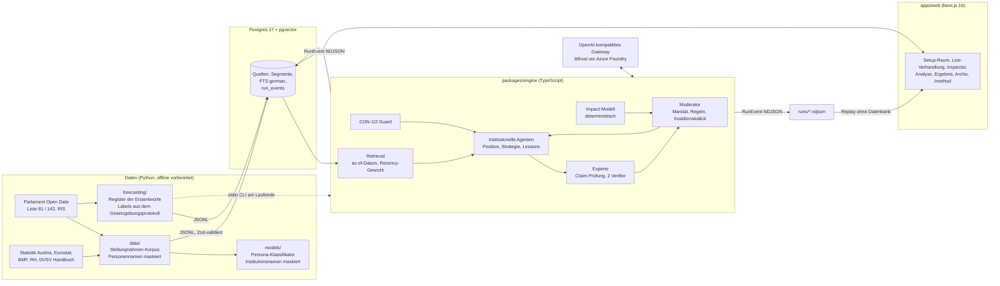

# HealthPolicy Simulator (KI Challenge, Use Case 2)

Transparenter Multi-Agenten-Simulator für gesundheitspolitische Verhandlungen in Österreich.
Institutionelle KI-Agenten (Gesundheitsministerium, Sozialversicherung, Ärztekammer,
Vertragsärzt:innen, Krankenanstalten, Pflege, Bundesländer, Patient:innenvertretung,
Finanzministerium, optional Gesetzgeber, Public Health, WK, AK, LK, Industrie) verhandeln eine
Fragestellung unter einem neutralen Moderator. Jede Position ist auf eine datierte
institutionelle Quelle zurückgeführt, jede Zahl wird von einem Experte-Agenten geprüft, jeder
Redebeitrag lässt sich bis zu Prompt, gefundenen Passagen und Modell aufklappen.
Es werden nur Institutionen abgebildet, nie reale Personen (CON-1, CON-2).

English summary: [below](#english-summary). Methodennotiz für die Jury: [`docs/method.md`](docs/method.md),
im Prototyp unter `/method`. Pitch und Klickpfad: [`docs/pitch.md`](docs/pitch.md).

**Trainierte Persona-Modelle:** neun LoRA-Adapter auf Qwen3-8B in drei Versionen (v1, v2, v2.1) mit Modellkarten und Messwerten auf
**[huggingface.co/Aryt3](https://huggingface.co/Aryt3)**; Ergebnisse pro Institution in [Abschnitt 1.8](#18-trainierte-persona-modelle-hugging-face).

---

## 1. Beschreibung der Lösung und des Ansatzes

### 1.1 Problem und Nutzen

Bevor der Dachverband eine Begutachtungs-Stellungnahme schreibt oder in eine
Honorarverhandlung geht, muss er abschätzen, wie die anderen Institutionen reagieren: Wer
blockiert, wer ist koalitionsfähig, wo liegen rote Linien, was kostet ein Kompromiss. Heute
geschieht das aus Erfahrung und Pressespiegel. Der Simulator macht diese Vorbereitung
wiederholbar und prüfbar: Er spielt die Verhandlung mit Agenten durch, deren Positionen aus den
echten, datierten Stellungnahmen der Institutionen stammen, und legt offen, warum ein Agent
welche Position vertritt und wann er sie ändert.

Das Ergebnis ist kein einzelner KI-Text, sondern das achtteilige Verhandlungsergebnis der
Aufgabenstellung (Ausgangsfrage, Akteure, Verlauf, Konfliktanalyse, Kompromissvorschläge,
Konsensanalyse, offene Streitpunkte, Auswirkungen) plus der vollständige, nachvollziehbare
Verlauf. Konsens wird nicht erzwungen: offene Konflikte und Minderheitspositionen stehen im
Ergebnis vor den Einigungen.

### 1.2 Architektur



Ein einziges Ereignisprotokoll (`RunEvent`, Zod, `packages/contracts/src/events.ts`) trägt Live-Läufe
und Replays. Ein reiner Reducer `foldRun` baut daraus den Zustand für Server und Browser. Ein
Replay liest dieselben Zeilen von der Platte, deshalb läuft die Demo auch ohne Netz und ohne
Datenbank (Akzeptanzkriterium 19).

### 1.3 Verhandlungsablauf

1. **Mandat.** Der Moderator übersetzt die Frage in einen Verhandlungsauftrag, wählt die
   Akteure mit Begründung und legt Entscheidungsregel, Rundenlimit und Budgetobergrenze fest.
2. **Positionsbildung.** Jeder Agent holt Belege aus dem Archiv, nur bis zum as-of-Datum des
   Laufs, und bildet seine Ausgangsposition mit Zitaten.
3. **Diskussion und Verhandlung** in Runden. Die Sprechreihenfolge wird pro Runde
   randomisiert und protokolliert; die zweite Hälfte antwortet auf die erste. Pro Agent und
   Runde entsteht eine strategische Einschätzung (Verhandlungsmacht, Vetostatus, BATNA,
   Koalitionsoptionen, Abhängigkeiten, Anreize, Kooperation oder Blockade).
4. **Koalitionskalkül.** Eine reine Funktion ohne Modellaufruf berechnet Vetospieler,
   minimale Gewinnkoalitionen und Blockierer. Sie entscheidet, welcher Kompromiss auf den
   Tisch kommt.
5. **Lernen zwischen Runden.** Jeder Agent schreibt eine Lesson, die in die nächste Runde
   eingeht (Vorgabe der Aufgabenstellung).
6. **Ergebnis.** Achtteiliges Dokument, Wirkungsabschätzung mit offen gelegten Annahmen,
   Referenzklassen-Prognose je Maßnahme.

### 1.4 Methoden und zentrale technische Entscheidungen

| Entscheidung                                          | Begründung                                                                                                                                                                                                                                                                                                                                                                                                                                                                                                                                                    |
| ----------------------------------------------------- | ------------------------------------------------------------------------------------------------------------------------------------------------------------------------------------------------------------------------------------------------------------------------------------------------------------------------------------------------------------------------------------------------------------------------------------------------------------------------------------------------------------------------------------------------------------- |
| **Referenzklassen-Prognose statt trainiertem Modell** | Über 18 Jahre gibt es nur 30 bis 60 echte Verhandlungsepisoden (Register: 165 gesundheitsbezogene Ministerialentwürfe in 156 Episoden), und die Kassenfusion 2019/2020 ist ein Strukturbruch. Ein Klassifikator auf dieser Basis ist nicht validierbar und würde Scheinpräzision liefern. Stattdessen: gezählte Basisraten vergleichbarer Erstentwürfe, "umgesetzt in k von n vergleichbaren Fällen", mit Jeffreys- bzw. Wilson-Intervall und Small-n-Warnung bei n < 5. Alle Regeln sind vor dem ersten Score in `forecasting/PREREGISTRATION.md` festgelegt |
| **Labels aus dem Gesetzgebungsprotokoll**             | Der Ausgang (umgesetzt, teilweise umgesetzt, abgelehnt, versandet, ersetzt) kommt mechanisch aus Parlament Open Data und RIS (Bundesgesetzblatt, dritte Lesung, Textähnlichkeit Entwurf zu Endfassung, VfGH-Aufhebungen), nie aus der Presse. Beschreibung und Label stammen damit aus getrennten Quellen, Leakage ist strukturell ausgeschlossen. Einheit ist der erste öffentliche Entwurf, nicht die Regierungsvorlage, denn rund 97 % der eingebrachten Regierungsvorlagen werden beschlossen                                                             |
| **Stellungnahmen als Positionsquelle**                | Begutachtungs-Stellungnahmen (Parlament Liste 142) sind datierte, formelle, institutionelle Positionen: 21.588 zugeordnete Stellungnahmen, davon 2.667 gesundheitsbezogene Texte. Sie erfüllen die Vorgabe "Standpunkte aus Medienberichten und Pressestatements, nachvollziehbar" besser als Pressezitate, weil sie keiner Person in den Mund gelegt sind. Grenze: Stellungnahmen sind Eröffnungspositionen, rote Linien brauchen eine zweite Quelle                                                                                                         |
| **Zwei Modellfamilien**                               | Homogene Debatten schlagen ein Einzelmodell nicht (Literatur in PRD 12). Agenten und Prüfung laufen deshalb über ein Gateway, das Modelle per Konfiguration tauscht; der zweite Verifier soll aus einer anderen Familie kommen (`SV_VERIFIER_MODEL`). Welche Modelle tatsächlich im Referenzlauf liefen, steht auf `/method`                                                                                                                                                                                                                                  |
| **Prüfung auf Claim-Ebene**                           | Der Experte zerlegt Aussagen in atomare Claims und prüft jeden gegen die zitierte Passage und gegen andere Zahlen. Zwei unabhängige Prüfaufrufe; Uneinigkeit lässt einen Claim "ungeprüft", ein Widerspruch markiert ihn als "widersprochen". Die Zustände geprüft, ungeprüft, widersprochen und Annahme werden nie zu einem "ok" zusammengelegt                                                                                                                                                                                                              |
| **Namensmaskierung**                                  | Personennamen werden vor jedem Modellschritt satzweise maskiert (spaCy NER, Titel-Regel, Namenslisten, Vornamen-Regel, Signaturzeichen) und von `check_leaks.py` und einem Guard in der Engine erneut geprüft; der Guard schlägt bei einem Treffer fehl. Für den Persona-Klassifikator werden zusätzlich Institutionsnamen durch `[INSTITUTION]` ersetzt, damit er am Stil und nicht am Namen lernt                                                                                                                                                           |
| **as-of-Retrieval**                                   | Jeder Lauf hat ein as-of-Datum; das Retrieval liefert nur Quellen mit Datum davor (SQL-Prädikat `src.date <= asOf`). Jüngere Quellen wiegen mehr (exponentieller Abfall, Halbwertszeit zwei Jahre), Gewicht und Alter stehen an jedem Zitat. Das erfüllt die Vorgabe "aktuelle Ereignisse stärker gewichten" und erlaubt einen Backtest auf einen historischen Stichtag                                                                                                                                                                                       |
| **Ein Ereignisformat für Live und Replay**            | NDJSON statt Chat-Stream: die Verhandlung ist kein Chat, und ein Replay ist "dieselben Zeilen erneut lesen". Die Demo hängt nicht an der Latenz des Gateways                                                                                                                                                                                                                                                                                                                                                                                                  |
| **Deterministisches Impact-Modell**                   | Kosten- und Wirkungszahlen kommen aus einer getesteten Funktion mit sichtbaren Eingaben. Eine offizielle Wartezeitenreihe existiert nicht, deshalb ist der Wartezeiteffekt als Annahme gekennzeichnet                                                                                                                                                                                                                                                                                                                                                         |
| **Koalitionskalkül ohne LLM**                         | Wer blockieren kann, folgt aus Vetostatus und Stimmen, nicht aus einer Modellmeinung. Damit ist der spieltheoretische Teil reproduzierbar                                                                                                                                                                                                                                                                                                                                                                                                                     |

Ausführlich, mit Grenzen: [`docs/method.md`](docs/method.md).

#### Forschungsgrundlage

Die wichtigsten umgesetzten Arbeiten, jeweils mit der Funktion, die sie geprägt haben. Alle 43
umgesetzten Paper mit Datei je Mechanismus, dazu die geprüften, aber nicht gebauten: [`docs/references.md`](docs/references.md).

- Debattenrunden: Du et al. 2023, [Multiagent Debate](https://arxiv.org/abs/2305.14325)
- Themenbindung, festgefahrene Austausche schließen: Becker et al. 2025, [Problem Drift](https://arxiv.org/abs/2502.19559)
- Zufällige, protokollierte Sprechreihenfolge: Zhang et al. 2025, [Who Holds the Power?](https://arxiv.org/abs/2511.11040)
- Konflikte vor Einigungen: Tessler et al. 2024, [Common ground in deliberation](https://doi.org/10.1126/science.adq2852)
- Rote Linien, kein Konsenszwang: Sharma et al. 2023, [Sycophancy](https://arxiv.org/abs/2310.13548)
- Koalitionskalkül: Tsebelis 2002, [Veto Players](https://doi.org/10.1515/9781400831456)
- Stufen der roten Linien: Weible, Sabatier, McQueen 2009, [Advocacy Coalition Framework](https://doi.org/10.1111/j.1541-0072.2008.00299.x)
- Atomare Claims: Min et al. 2023, [FActScore](https://arxiv.org/abs/2305.14251)
- Claim gegen zitierte Passage: Gao et al. 2023, [ALCE](https://arxiv.org/abs/2305.14627)
- Prüfung durch andere Modellfamilie: Panickssery, Bowman, Feng 2024, [Self-preference](https://arxiv.org/abs/2404.13076)
- as-of-Retrieval: Halawi et al. 2024, [Human-Level Forecasting](https://arxiv.org/abs/2402.18563)
- Lookahead, Recall-Probe: Sarkar, Vafa 2024, [Lookahead Bias](https://conference.nber.org/conf_papers/f205530/f205530.pdf)
- Referenzklassen-Prognose: Kahneman, Lovallo 1993, [Timid Choices and Bold Forecasts](https://doi.org/10.1287/mnsc.39.1.17)
- Wilson- und Jeffreys-Intervall: Brown, Cai, DasGupta 2001, [Binomial Proportion](https://doi.org/10.1214/ss/1009213286)
- Präferenzerreichung im Backtest: Klüver 2009, [Interest Group Influence](https://doi.org/10.1177/1465116509346782)

### 1.5 Datenquellen und Lizenzen

| Quelle                                                                                                      | Verwendung                                                                                                                                                                                                         | Lizenz                                                                                                                                                                 |
| ----------------------------------------------------------------------------------------------------------- | ------------------------------------------------------------------------------------------------------------------------------------------------------------------------------------------------------------------ | ---------------------------------------------------------------------------------------------------------------------------------------------------------------------- |
| Parlament Österreich Open Data (Ministerialentwürfe Liste 81, Stellungnahmen Liste 142, Vorlagen Liste 101) | Stellungnahmen-Index, Prognoseregister, Labels                                                                                                                                                                     | CC BY 4.0, "Quelle: Parlament Österreich"                                                                                                                              |
| RIS (Bundesgesetzblatt, VfGH-Kundmachungen)                                                                 | Labels: Inkrafttreten, Aufhebungen                                                                                                                                                                                 | CC BY 4.0                                                                                                                                                              |
| Texte der Begutachtungs-Stellungnahmen                                                                      | Positionen, Persona-Fitting, Zitate (maskiert)                                                                                                                                                                     | Rechte bei den einreichenden Institutionen. PDFs bleiben in `data/raw/` und werden nicht veröffentlicht; abgeleiteter Text nur mit Zitat, nicht als Ganzes weitergeben |
| Statistik Austria OGD, Eurostat, BMF UG 24, Rechnungshof Bundesrechnungsabschluss                           | Impact-Eingaben, Zahlenprüfung                                                                                                                                                                                     | CC BY 4.0                                                                                                                                                              |
| DVSV Statistisches Handbuch, ÖÄK Ärztestatistik, Zielsteuerung-Monitoringberichte                           | Kassenstellen, Ärzt:innenzahlen, Zielwerte                                                                                                                                                                         | keine offene Lizenz angegeben; zitiert, interne Nutzung, Weitergabe nur nach Rückfrage                                                                                 |
| Pressespiegel (SV-Box)                                                                                      | Vollständig durchsucht: 4.147 Ausgaben, 223.909 Seiten (2008 bis 2026), 63.618 Seitentreffer mit Institution, 10.277 Kandidaten, 1.406 ausgewertet, 636 personenfreie Positionen; 606 Originalseiten mit Textebene | laut Teilnahmeinformation frei verteilbar; trotzdem nicht als Ganzes ins Repo gelegt. APA-OTS wird nicht gecrawlt (`tdm-reservation: 1`)                               |

Details: `data/README.md`, `data/STATS.md`, `forecasting/README.md`, `models/README.md`.

### 1.6 Übernommen versus hier gebaut (CON-6)

**In einem Satz:** UI-Bausteine, Design-Tokens, das NDJSON-Streaming-Muster und der Gateway-Client
stammen aus dem früheren Projekt eines Teammitglieds (medlyn, Quellen-verknüpfte klinische
Evidenz); Verhandlungs-Engine, Agentenkonstruktion, Koalitionskalkül, Experte-Prüfung,
Datenkorpus, Prognose und alle Visualisierungen der Verhandlung sind in dieser Challenge entstanden.

| Übernommen aus medlyn (eigene Vorarbeit des Teams)                               | In der Challenge gebaut                                                                                                                  |
| -------------------------------------------------------------------------------- | ---------------------------------------------------------------------------------------------------------------------------------------- |
| shadcn/ui-Primitive und Design-Tokens (`apps/web/components/ui`), Theme-Handling | Verhandlungs-Engine: Moderator, Agenten, Runden, Lessons (`packages/engine`)                                                             |
| Muster NDJSON-über-fetch für Streaming                                           | `RunEvent`-Protokoll, `foldRun`, Replay mit Zeitachse (`packages/contracts`)                                                             |
| Muster des Gateway-Clients mit striktem JSON-Schema (`structured()`)             | Koalitionskalkül, strategische Einschätzung, Impact-Modell, CON-1/2-Guard                                                                |
| Konvention "Claim-Boundary": nichts erreicht die UI ohne geprüfte Quelle         | Experte mit zwei Verifiern, Claim-Zustände                                                                                               |
|                                                                                  | Stellungnahmen-Korpus mit Maskierung, Statistik-Katalog (`data/`)                                                                        |
|                                                                                  | Register der Erstentwürfe, Labels, Referenzklassen-Prognose (`forecasting/`)                                                             |
|                                                                                  | Persona-Klassifikator und Fine-Tuning-Kit (`models/`)                                                                                    |
|                                                                                  | Alle Screens: Setup-Raum, Live-Verhandlung, Inspector, Trajektorien, Konsensmatrix, Koalitionsgraph, Ergebnisdokument, Archiv, `/method` |

medlyn steht unter CC BY-NC 4.0; diese Lizenz bindet Dritte, nicht den Urheber. Der Urheber ist
Teammitglied und gewährt die Nutzung der übernommenen Teile für dieses Repository. shadcn/ui
ist MIT-lizenziert.

### 1.7 Time-to-Impact

**Erster praktischer Nutzen für den Dachverband:** Vorbereitung einer Begutachtungs-Stellungnahme
oder einer Honorarverhandlung. Ein:e Analyst:in gibt den Entwurf oder das Verhandlungsziel ein,
der Simulator zeigt, welche Institutionen voraussichtlich wie reagieren, wer blockieren kann,
welche Koalitionen möglich sind und wie oft vergleichbare Entwürfe historisch umgesetzt wurden.
Die Ausgabe ist eine Vorbereitungsunterlage mit Quellen, keine Entscheidung.

**Was es für den Echtbetrieb braucht:**

- Konnektor zum internen Archiv (SOZDOK, Pressespiegel) statt der lokalen Kopie
- eigenen Azure-Tenant des Dachverbands hinter dem Gateway (nur Konfiguration, kein Code)
- Review jeder Simulation durch eine:n Policy-Analyst:in, bevor sie verwendet wird

**Nächste drei Schritte:**

1. Backtest SV-OG 2018 und PrimVG 2017 ausführen und das Ergebnis veröffentlichen, mit der
   vorab formulierten Erwartung, dass der Simulator bei der SV-OG weicher ausfällt (siehe
   Einschränkungen).
2. Rote Linien aus einer zweiten Quelle (Pressespiegel, Verhandlungsprotokolle) absichern und
   die Stance-Labels an rund 200 Passagen von Fachleuten gegenprüfen lassen.
3. Pilot mit einer Fachabteilung an einem laufenden Begutachtungsverfahren, Simulation vor
   Fristende, Vergleich mit den tatsächlich eingehenden Stellungnahmen danach.

---

### 1.8 Trainierte Persona-Modelle (Hugging Face)

27 LoRA-Adapter auf `Qwen/Qwen3-8B` (Apache-2.0) in drei Versionen, je einer pro Institution mit ausreichend Stellungnahmen, trainiert auf SageMaker (`ml.g6e.xlarge`): **v1** (nur Stellungnahmen, 3 Epochen), **v2** (plus Haltungs-Präfix und personenfreie Presse-Texte, 2 Epochen, unterangepasst) und **v2.1** (v2-Daten mit dem v1-Schema, mindestens 36 Schritte pro Adapter). Alle unter **[huggingface.co/Aryt3](https://huggingface.co/Aryt3)**, jeweils mit Model Card, Vergleichstabelle und Messwerten. Die Repositories sind privat; hochgeladen sind nur Adaptergewichte, Konfiguration und Karte, keine Trainingsdaten.

Auswertung auf zurückgehaltenen Stellungnahmen ab 2023, Anteil mit derselben Haltungsrichtung wie die echte Stellungnahme (v2.1 / prompt-gesteuertes Basismodell):

| Institution         | Repositories                                                                                                                                                                                                                                        |   n | Haltung getroffen v2.1 / Basis |
| ------------------- | --------------------------------------------------------------------------------------------------------------------------------------------------------------------------------------------------------------------------------------------------- | --: | -----------------------------: |
| Krankenanstalten    | [v1](https://huggingface.co/Aryt3/sv-persona-hospitals-qwen3-8b-lora) · [v2.1](https://huggingface.co/Aryt3/sv-persona-hospitals-qwen3-8b-lora-v21) · [v2](https://huggingface.co/Aryt3/sv-persona-hospitals-qwen3-8b-lora-v2)                      |  28 |    0,71 / 0,66 **v2.1 besser** |
| Ärztekammer         | [v1](https://huggingface.co/Aryt3/sv-persona-medical_chamber-qwen3-8b-lora) · [v2.1](https://huggingface.co/Aryt3/sv-persona-medical_chamber-qwen3-8b-lora-v21) · [v2](https://huggingface.co/Aryt3/sv-persona-medical_chamber-qwen3-8b-lora-v2)    |  30 |    0,70 / 0,69 **v2.1 besser** |
| Pflegevertretung    | [v1](https://huggingface.co/Aryt3/sv-persona-nursing-qwen3-8b-lora) · [v2.1](https://huggingface.co/Aryt3/sv-persona-nursing-qwen3-8b-lora-v21) · [v2](https://huggingface.co/Aryt3/sv-persona-nursing-qwen3-8b-lora-v2)                            |  30 |    0,70 / 0,53 **v2.1 besser** |
| Patientenvertretung | [v1](https://huggingface.co/Aryt3/sv-persona-patients-qwen3-8b-lora) · [v2.1](https://huggingface.co/Aryt3/sv-persona-patients-qwen3-8b-lora-v21) · [v2](https://huggingface.co/Aryt3/sv-persona-patients-qwen3-8b-lora-v2)                         |  12 |    0,58 / 0,46 **v2.1 besser** |
| Sozialversicherung  | [v1](https://huggingface.co/Aryt3/sv-persona-social_insurance-qwen3-8b-lora) · [v2.1](https://huggingface.co/Aryt3/sv-persona-social_insurance-qwen3-8b-lora-v21) · [v2](https://huggingface.co/Aryt3/sv-persona-social_insurance-qwen3-8b-lora-v2) |  30 |    0,60 / 0,55 **v2.1 besser** |
| Arbeiterkammer      | [v1](https://huggingface.co/Aryt3/sv-persona-chamber_labour-qwen3-8b-lora) · [v2.1](https://huggingface.co/Aryt3/sv-persona-chamber_labour-qwen3-8b-lora-v21) · [v2](https://huggingface.co/Aryt3/sv-persona-chamber_labour-qwen3-8b-lora-v2)       |  30 |                    0,50 / 0,68 |
| Bundesländer        | [v1](https://huggingface.co/Aryt3/sv-persona-laender-qwen3-8b-lora) · [v2.1](https://huggingface.co/Aryt3/sv-persona-laender-qwen3-8b-lora-v21) · [v2](https://huggingface.co/Aryt3/sv-persona-laender-qwen3-8b-lora-v2)                            |  30 |                    0,50 / 0,58 |
| Wirtschaftskammer   | [v1](https://huggingface.co/Aryt3/sv-persona-chamber_commerce-qwen3-8b-lora) · [v2.1](https://huggingface.co/Aryt3/sv-persona-chamber_commerce-qwen3-8b-lora-v21) · [v2](https://huggingface.co/Aryt3/sv-persona-chamber_commerce-qwen3-8b-lora-v2) |  30 |                    0,37 / 0,53 |
| Finanzministerium   | [v1](https://huggingface.co/Aryt3/sv-persona-ministry_finance-qwen3-8b-lora) · [v2.1](https://huggingface.co/Aryt3/sv-persona-ministry_finance-qwen3-8b-lora-v21) · [v2](https://huggingface.co/Aryt3/sv-persona-ministry_finance-qwen3-8b-lora-v2) |  24 |                    0,21 / 0,39 |
| **Gesamt**          |                                                                                                                                                                                                                                                     | 244 |                    0,55 / 0,57 |

Ergebnis: v2.1 schlägt das Basismodell bei der Haltung für fünf Institutionen (Krankenanstalten, Ärztekammer, Pflege, Patientenvertretung, Sozialversicherung), liegt insgesamt knapp dahinter (In-Character 0,38 / 0,46) und hinter dem Dossier-Ansatz auf qwen3-235b (Haltung 0,64, In-Character 0,57). v1 (Haltung 0,44, mit Inferenz-Fix 0,50) schlägt die Basis bei der Haltung nur für zwei bzw. drei Institutionen; v2 (0,30) ist schwächer als v1 und das Basismodell und bleibt nur zur Transparenz veröffentlicht. Die Agenten nutzen deshalb standardmäßig Frontier-Modelle mit datengestützten Positionsprofilen; die Adapter sind ein gemessenes Experiment, vergleichbar live im Tab **Modelle** (`/models`). Details: `models/README.md`, `models/out/eval_v2.md`, `models/out/eval_sagemaker.md`.

## 2. Anleitung zur Ausführung

Schnellstart ohne Datenbank und ohne Modellzugang (Replay des Referenzlaufs):

```bash
pnpm install
pnpm dev                      # http://localhost:3000, Läufe kommen aus runs/*.ndjson
```

Vollständig, mit Datenbank und Live-Läufen:

```bash
pnpm install
cp .env.example .env          # Gateway-URL und Schlüssel für Live-Läufe eintragen
pnpm db:up                    # pgvector-Container auf 127.0.0.1:55432
pnpm db:migrate               # Migrationen anwenden
pnpm db:import                # Quellen und Track-JSONL importieren
pnpm runs:load                # runs/*.ndjson in run_events und Read-Models laden
pnpm dev                      # http://localhost:3000
```

Ein Lauf auf der Kommandozeile und der Gateway-Smoke-Test (NFR-10):

```bash
pnpm --filter @sv/engine smoke "azure/<modell-a>,azure/<modell-b>"
pnpm --filter @sv/engine run:once
```

Wichtige Wege im Prototyp: `/` Übersicht, `/runs/new` Setup-Raum, `/runs/<id>` Live-Verhandlung,
`/runs/<id>/inspect/<utterance>` Inspector, `/runs/<id>/analysis` Trajektorien und Koalitionen,
`/runs/<id>/result` Ergebnisdokument, `/archive` Evidenzarchiv, `/method` Methodennotiz.
Replay-API: `GET /api/runs/<runId>/stream?from=<seq>&speed=<x>` (NDJSON, `speed=0` sendet alles
sofort), Liste: `GET /api/runs`.

Prüfungen: `pnpm typecheck`, `pnpm lint`, `pnpm test`, `pnpm build`.

Daten-, Prognose- und Persona-Tracks (Python) werden offline vorbereitet; ihre Ausgaben liegen
im Repo, ein Neuaufbau ist optional. Befehle in `data/README.md`, `forecasting/README.md`,
`models/README.md`.

---

## 3. Abhängigkeiten und Voraussetzungen

- Node.js 24 oder neuer (Skripte laufen TypeScript direkt über Node Type Stripping), pnpm 10
- Docker für Postgres 17 + pgvector; optional, ohne Datenbank fällt die App auf `runs/` zurück
- Für Live-Läufe: ein OpenAI-kompatibles Gateway (Bifrost oder direkt ein Azure-Foundry-v1-Endpunkt)
- Für die Python-Tracks: Python 3.12 und uv; `data/` zusätzlich spaCy `de_core_news_lg` und poppler (`pdftotext`)
- Optional für das Persona-Fine-Tuning: eine GPU-VM (24 bis 80 GB) oder Azure Foundry Managed Training

Kernbibliotheken: Next.js 16, React 19, Tailwind 4, shadcn/ui und Radix, recharts, Zod 4,
drizzle-orm, turbo, Biome, vitest; Python: requests, pypdf, spaCy, SetFit, PEFT/TRL.

---

## 4. Konfigurationsschritte

`.env` im Repo-Wurzelverzeichnis (Vorlage `.env.example`, wird nie committet):

| Variable                                                | Zweck                                                                                                     |
| ------------------------------------------------------- | --------------------------------------------------------------------------------------------------------- |
| `OPENAI_COMPATIBLE_BASE_URL`                            | Basis-URL des Gateways für alle Modellaufrufe                                                             |
| `OPENAI_COMPATIBLE_API_KEY`                             | Gateway-Schlüssel (nie committen, nie ausgeben)                                                           |
| `SV_DEFAULT_MODEL`                                      | Modell der Agenten und des Moderators (Standard `azure/gpt-6-sol`)                                        |
| `SV_EXPERT_MODEL`                                       | Modell des Experte-Agenten (Standard: wie oben)                                                           |
| `SV_VERIFIER_MODEL`                                     | Zweiter Verifier fest vorgeben (sonst je Aussage aus `SV_VERIFIER_MODELS`, nie die Familie des Sprechers) |
| `SV_SEAT_MODELS`                                        | Sitzplan überschreiben, z. B. `gm=gpt,sv=deepseek` (Kürzel oder volle IDs)                                |
| `SV_BEDROCK_STRUCTURED`                                 | `tool` oder `json`: strukturierte Ausgabe auf Bedrock erzwingen (Standard je Modell)                      |
| `SV_LLM_CONCURRENCY`                                    | Parallele Modellaufrufe (Standard 24)                                                                     |
| `DATABASE_URL`                                          | Postgres-Verbindung; nicht erreichbar heißt Fallback auf `runs/`                                          |
| `SV_REPLAY_DIR`                                         | Verzeichnis der gespeicherten Läufe (Standard `runs`)                                                     |
| `SV_FORECAST_CMD`                                       | Optional: Prognose-CLI, wird am Ende eines Live-Laufs einmal aufgerufen                                   |
| `BIFROST_SEED_AZURE_ENDPOINT`, `BIFROST_SEED_AZURE_KEY` | Azure-Foundry-Zugang für das Gateway und das Fine-Tuning-Skript                                           |

Agentenprofile (Ziele, Interessen, Restriktionen, Budget, Prioritäten, Temperament, Vetostatus)
liegen als Daten in `packages/engine/config/agents.json`, Szenario-Vorlagen in
`packages/engine/config/templates.json`; Änderungen brauchen keinen Code (NFR-3). Modellwahl pro
Agent erfolgt im Setup-Raum.

Ergebnisse für die Methodenseite: `runs/method-note.json` (Modellpalette, Smoke-Test, Prognose-
Scores, Backtest). Felder mit `null` werden auf `/method` als "noch nicht gemessen" angezeigt.

---

## 5. Bekannte Einschränkungen und offene Punkte

- **Kleine Stichprobe.** Die Prognose stützt sich auf 30 bis 60 Episoden. Intervalle sind breit;
  die Ablation "Presse-Merkmale gegen Basis" wird bei diesem n voraussichtlich "nicht
  entscheidbar" ergeben, und genau so wird sie berichtet.
- **Lookahead-Risiko.** Frontier-Modelle kennen den Ausgang vergangener Reformen. Ein Treffer im
  Backtest ist daher schwache Evidenz; Labels und Register sind regelbasiert, ohne LLM.
- **SV-OG 2018 wurde einseitig beschlossen**, gegen die Mehrheit der 75 Stellungnahmen. Ein
  kompromissorientierter Simulator wird erwartbar weicher ausfallen als das Gesetz; das ist
  vorab als Hypothese festgehalten, nicht nachträglich erklärt.
- **Stance-Labels sind teilweise LLM-abgeleitet.** Für deutschsprachige Gesundheitspolitik gibt es
  keinen gelabelten Datensatz; Labels sind stichprobenartig geprüft, nicht vollständig.
- **Dünne Akteure.** Wahlärzt:innen haben keine einzige Stellungnahme, das Gesundheitsministerium
  nur 4 (es schreibt die Entwürfe). Diese Agenten stützen sich auf Entwurfstexte und Presse und
  sind im Setup-Raum als "prompted" statt "fitted" markiert.
- **Maskierung ist best effort.** Regel- und NER-basiert, 0 Regeltreffer nach Maskierung, aber
  keine gemessene Recall-Zahl; seltene Nachnamen ohne Titel können durchrutschen.
- **Prozessrealismus ist nicht gemessen.** Die Prognose misst Plausibilität des Ergebnisses, die
  Persona-Treue misst Nähe zur historischen Position; ob der Verlauf realistisch ist, misst
  nichts davon.
- **Offen:** Vektor-Retrieval (Embeddings noch nicht importiert, nur deutsche Volltextsuche),
  303 gescannte Stellungnahmen ohne OCR, Azure-Fine-Tuning der Persona-Modelle serverseitig
  blockiert (HTTP 500, Details `models/README.md`), Robustheitsstudie über Modellpermutationen nur
  teilweise. Was am Jurytag fehlt, steht auf `/method` unter "Grenzen".
- **Kein Produktivsystem.** Keine Anbindung an SV-Systeme, keine Authentifizierung, keine echten
  Gesundheits- oder Versichertendaten.

---

## English summary

**What it is.** A transparent multi-agent simulator of Austrian health-policy negotiations
(DVSV KI Challenge, Use Case 2). Institutional agents negotiate a question under a neutral
moderator; every position cites a dated institutional source, every figure is checked by an
Experte agent, and every utterance opens down to its prompt, retrieved passages and model.
Institutions only, never real persons.

**Key decisions.** Reference-class forecasting instead of a trained model, because there are only
30 to 60 real episodes across a structural break (the 2019-2020 carrier merger); outcome labels
come mechanically from the legislative record (Parlament open data, RIS), never from the press;
positions come from formal Begutachtungs-Stellungnahmen (21,588 indexed, 2,667 health texts);
two model families via one OpenAI-compatible gateway; claim-level verification by two verifier
calls; person names masked before any model sees text, institution names masked for the persona
classifier; as-of retrieval with a two-year recency half-life.

**Inherited vs built.** UI primitives, design tokens, the NDJSON streaming pattern and the gateway
client pattern come from a team member's earlier project (medlyn); the negotiation engine, agent
construction, coalition calculus, verification, data corpus, forecasting and all negotiation
views were built for this challenge.

**Run.** `pnpm install && pnpm dev` replays the reference run from `runs/` with no database and no
model access. Live runs need `.env` with an OpenAI-compatible gateway (section 4).

**Limits.** Small n, lookahead risk of frontier models, the SV-OG 2018 backtest was a unilateral
reform so the simulator is expected to come out softer, stance labels are partly LLM-derived,
masking is best effort, process realism is not measured.

**Time to impact.** First use: preparing a Begutachtungs-Stellungnahme or a fee negotiation by
simulating the other institutions. Needs an internal archive connector, the Dachverband's own
Azure tenant and analyst review. Next steps: run and publish the backtests, second-source the red
lines with expert-checked labels, pilot on a live consultation.

Trained persona adapters, versions v1, v2 and v2.1 (private, with model cards and evaluation): https://huggingface.co/Aryt3

## Repository

```
apps/web            Next.js 16 app (Übersicht, Setup-Raum, Verhandlung, Replay, Archiv, /method)
packages/contracts  Zod-Schemas, RunEvent-Protokoll, foldRun, Agentenkatalog, JSON-Schema-Export
packages/engine     Moderator, Agenten, Experte, Retrieval, Koalitionskalkül, Impact-Modell, CLI
packages/db         drizzle-orm Schema, Migrationen, Run-Store, JSONL-Importer
runs/               gespeicherte Läufe (NDJSON) und method-note.json
data/               Stellungnahmen-Korpus und Statistik-Katalog (Python)
forecasting/        Register, Labels, Referenzklassen-Prognose (Python)
models/             Persona-Klassifikator, Fine-Tuning-Kit (Python)
docs/               Methodennotiz, Pitch, Coverage-Matrix, UI-Plan, Git-Workflow
```

Anforderungen: PRD `uc2-requirements.md` v2.11 (außerhalb des Repos), Abdeckung der
Aufgabenstellung und Jurykriterien: [`docs/coverage-matrix.md`](docs/coverage-matrix.md).
